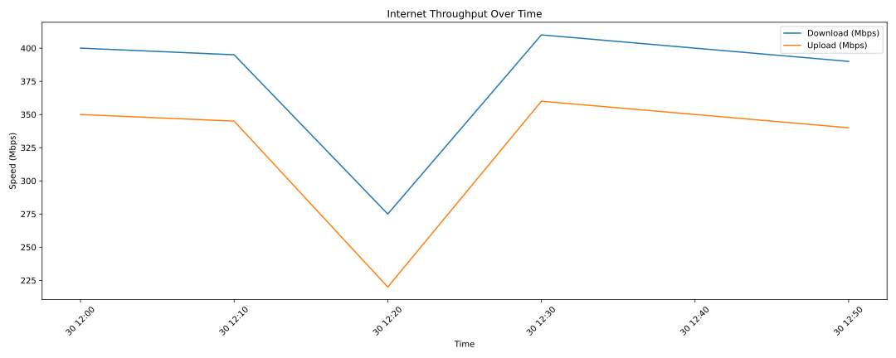

# Network Analyzer

[](https://github.com/apakoning/network-analyzer/actions/workflows/python-checks.yml)

Track a Linux connection over time: collect download/upload speed, latency and jitter into CSV, print statistical summaries, and generate separate throughput and latency graphs.

Built from a practical need to document connection behaviour beyond a single speed test. Collection, cleaning, analysis and plotting are separate components.

## Install

Requires Linux, Python 3.9+, `ping`, `flock` (util-linux) and the **official Ookla Speedtest CLI**, not the similarly named Python `speedtest-cli` package. Obtain the CLI from [Ookla](https://www.speedtest.net/apps/cli) and run it manually first to review and accept its terms if you choose to use it. The collector does not automatically accept agreements.

```bash
git clone https://github.com/apakoning/network-analyzer.git
cd network-analyzer
python3 -m venv .venv
source .venv/bin/activate
python -m pip install -r requirements.txt
speedtest --version
```

Keep this virtual environment activated when using the wrapper, or set `NETLOG_PYTHON` to its Python executable.

## Try it without network measurements

The example CSV contains **synthetic data**, including a failed measurement:

```bash
python netlog_analyze.py --log-file examples/sample-netlog.csv
MPLBACKEND=Agg python netlog_plot.py --log-file examples/sample-netlog.csv \
  --speed-graph /tmp/netlog-speed.png --latency-graph /tmp/netlog-latency.png
```



## Collect and inspect

```bash
# One measurement in the foreground:
python netlog_collect.py --once

# Continuous background collection; default interval is 15 minutes:
bash netlog_watch.sh start
bash netlog_watch.sh status
bash netlog_watch.sh analyze
MPLBACKEND=Agg bash netlog_watch.sh plot
bash netlog_watch.sh stop
```

Speed tests transfer substantial data and temporarily load the connection. The default is 900 seconds between cycle starts; a cycle that takes longer delays the next start. Ping sampling defaults to 20 seconds against `1.1.1.1`. Measurements are sequential: the ping window occurs before the speed test, so it does not measure latency under speed-test load.

## Results and limitations

- Download/upload: Mbps, converted from Ookla's bytes per second.
- Latency: milliseconds; minimum, mean and maximum over the ping window.
- Jitter: mean absolute difference between successive ping RTT samples, not a universal jitter standard.
- Failed commands write empty measurement fields. Throughput summaries exclude failed speed tests and report their count. They are **not availability or packet-loss statistics**.
- Missing ping windows are not averaged as zero latency. Older all-zero ping failures are also treated as missing.
- Problem-window flags use sample percentiles. They highlight relative extremes, not proven ISP faults.
- Times are local, without timezone offsets. Keep one dataset on a consistent host timezone.
- The wrapper manages one collector per state directory and checks the recorded PID's command before stopping it. It is a user-session helper, not a supervised system service.

## Files and configuration

| Item | Default |
| --- | --- |
| CSV and graphs | `~/.local/share/netlog/` |
| PID and collector output | `~/.local/state/netlog/` |
| CSV columns | `time,speedtest_ping,latency_min,latency_avg,latency_max,jitter,download,upload` |

The wrapper honours `XDG_DATA_HOME`, `XDG_STATE_HOME`, `NETLOG_DATA_DIR`, `NETLOG_STATE_DIR`, `NETLOG_LOG_FILE` and `NETLOG_PYTHON`. Direct Python commands use their documented home-directory defaults unless passed explicit paths. [USAGE.md](USAGE.md) has custom-path examples.

## Project layout

| File | Role |
| --- | --- |
| `netlog_collect.py` | Ping and speed-test collection; standard library only |
| `netlog_data.py` | Shared CSV validation and cleaning |
| `netlog_analyze.py` | Summary statistics and percentile flags |
| `netlog_plot.py` | Throughput and latency graphs |
| `netlog_watch.sh` | Start, stop, status, analysis, plotting and tail commands |
| `tests/` | Offline regression tests with mocked measurement commands |

```bash
python -m unittest discover -s tests -v
```

CI runs on Python 3.9 and 3.11, exercises synthetic-data analysis and plotting, and never runs a live speed test.

## Origin and license

Extracted from [Handy-Scripts](https://github.com/apakoning/Handy-Scripts/tree/main/network/Network-Analyzer). Earlier development history remains there. [MIT](LICENSE). Maintained by [Alain A.P. Koningverdraag](https://github.com/apakoning).
